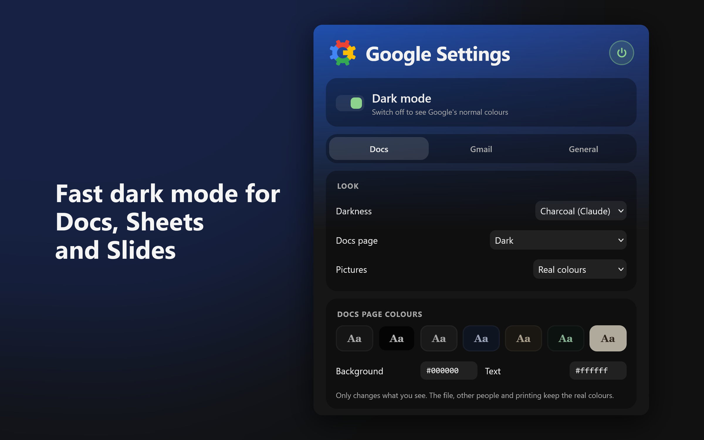
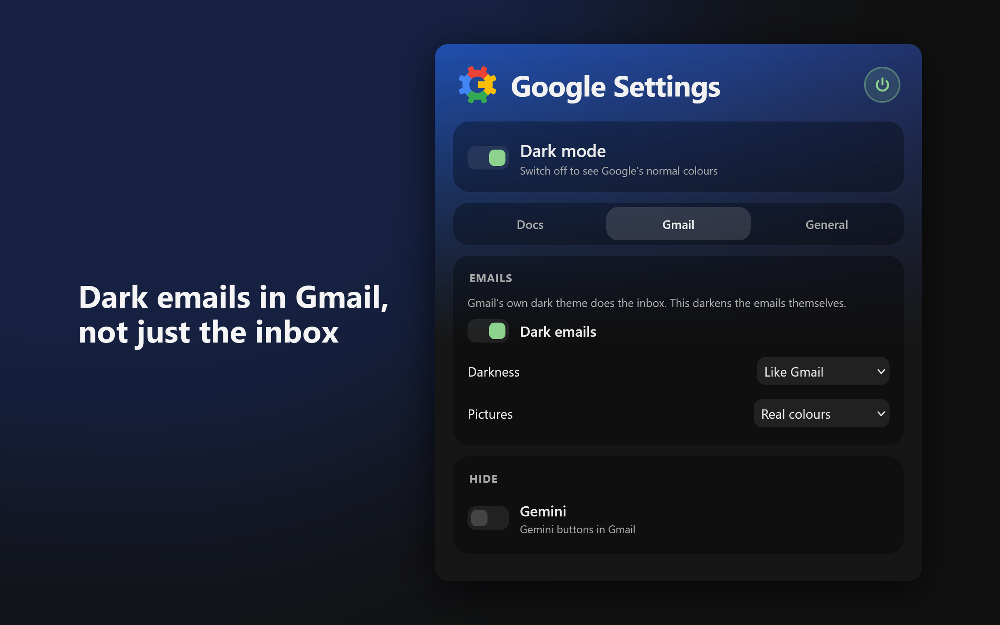
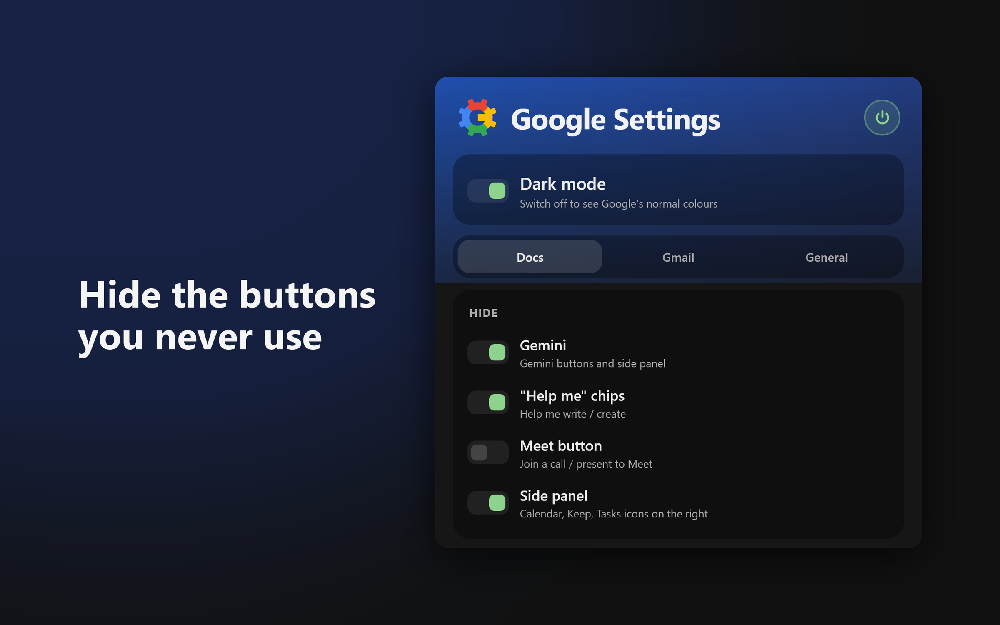

# More Settings for Google Apps

A Firefox add-on that gives Google Docs, Sheets, Slides, Forms and Gmail a fast dark mode, plus options to hide Gemini and other clutter.

**[Install from Firefox Add-ons](https://addons.mozilla.org/firefox/addon/more-settings-for-google-apps/)** (Firefox 128 or later)

## Features

- **Dark mode** for Docs, Sheets, Slides and Forms, with a choice of darkness (charcoal, soft, dark grey or black). Turn it off per app.
- **Your own page colours** in Docs, like white text on black. Only what you see changes: the file, other people and printing keep the real colours.
- **Dark emails in Gmail**: Gmail's own dark theme leaves opened emails white, so this darkens just the email. Keep Gmail's theme on Dark.
- **Pictures keep their real colours**, or dim them, or make them dark too.
- **Hide clutter**: Gemini, "Help me" chips and the right-hand side panel (hidden by default), and optionally the Meet button.
- **Thin scrollbars** (off by default).

Drive and Calendar aren't included: they have Google's own dark theme.

## Why it's fast

Most dark-mode add-ons recolour the page bit by bit with JavaScript, which lags in Docs because the page changes as you type. This one puts a single colour filter on the page, drawn by the graphics card, and gives pictures the opposite filter so they keep their colours. Nothing watches the page.

## Known limits

- Pictures inside a document are drawn together with the text, so in "Dark" they get flipped with the page. Set **Docs page** to "Dimmed white" or "White" to see them in true colours.
- Very strong colours (bright red, yellow) look a little muted.
- Inside pop-up frames (share dialog, file picker), photos may show as negatives.
- With Windows high contrast on, dark mode stays off so your contrast colours win. Clean-up still works.

## Privacy

- Collects no data and makes no network requests. Settings are stored in Firefox on your own computer.
- Only runs on docs.google.com and mail.google.com, and touches no other site.

## Report a problem

Open an issue on the [Issues page](https://github.com/TimWJT/more-settings-for-google-apps/issues). Say which app (Docs, Sheets, Gmail...), what you expected, what happened, and your Firefox version.

## For developers

- Run from source: open `about:debugging#/runtime/this-firefox`, click **Load Temporary Add-on** and pick `manifest.json`. Open a Google Doc. After editing a file, click **Reload** on the add-on there and refresh the tab.
- Build: `npx web-ext build --overwrite-dest --ignore-files "*.md"`
- The filter maths is explained at the top of `dark.css`. Test steps and the status of the clean-up selectors are in [TESTING.md](TESTING.md).

## Licence

All Rights Reserved. The source is public so it can be read and reviewed. See [LICENSE](LICENSE).

Not affiliated with Google.
